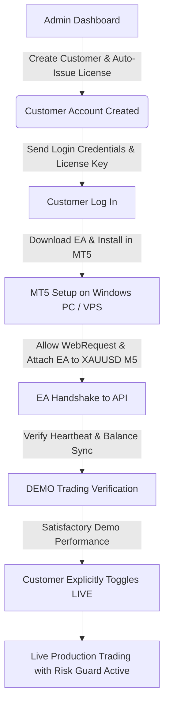

# Commercial Operations Runbook & Cost Architecture

This runbook covers infrastructure costs, customer onboarding flow, scalability considerations, and production security checks.

---

## 1. Infrastructure Cost Blueprint (in INR)

| Tier | Scale | Web & API Hosting | Windows VPS / MT5 | Domain & SSL | Approximate Total Cost / Month |
| :--- | :--- | :--- | :--- | :--- | :--- |
| **Development** | 1 Dev | Local PC (₹0) | Local PC (₹0) | Self-signed (₹0) | **₹0 / month** |
| **Low-Cost MVP** | 1–10 Traders | Shared Hosting (₹150 – ₹300/mo) | Windows VPS (₹600 – ₹1,000/mo) | .com Domain (₹70/mo amortized) | **₹800 – ₹1,400 / month** |
| **Production Scale**| 50–100 Traders | Cloud VPS (₹800 – ₹1,500/mo) | Multi-Terminal VPS (₹1,500 – ₹3,000/mo)| SSL + CDN (₹0 Cloudflare) | **₹2,300 – ₹4,500 / month** |

---

## 2. Customer Onboarding Workflow

---

## 3. Commercial Scalability Roadmap

- **1–10 Customers**: Direct PHP PDO on shared hosting + single Windows VPS running MT5 instances.
- **50 Customers**: Enable MySQL connection pooling, Redis caching for license verification, separate MT5 terminals across 2-3 VPS nodes.
- **100–500 Customers**: Move PHP API to lightweight load-balanced container or dedicated cloud instance; implement background queue for position snapshots; dedicated MT5 master signals.

---

## 4. Production Security Verification Checklist

- [x] **No Plaintext Passwords**: Bcrypt (cost 12) utilized for all user authentications.
- [x] **Zero Secret Leaks**: All secrets kept in `.env` outside web root; `.env.example` committed.
- [x] **SQL Injection Defense**: 100% prepared statements via PDO parameters.
- [x] **CORS Enforcement**: Whitelisted domain origin checks on all API responses.
- [x] **HTTPS Mandatory**: WebRequest encryption for all EA communications.
- [x] **Audit & Bot Logs**: Comprehensive event trail stored in database.
- [x] **Fail-Safe & Kill Switch**: Immediate cessation of order generation on remote kill switch activation or license suspension.
